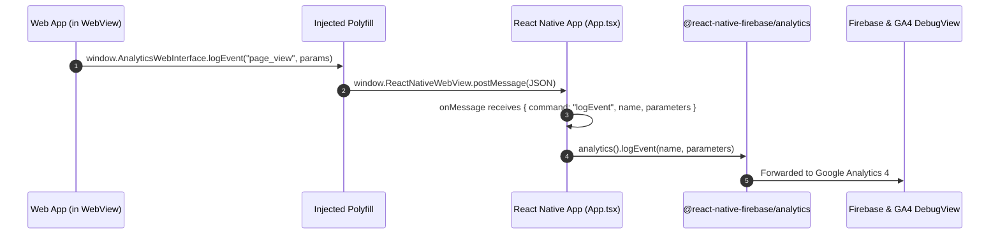

# React Native WebView Analytics Tracking

A complete React Native application demonstrating end-to-end WebView analytics tracking with **Google Analytics 4 (GA4)** and **Firebase Analytics**.

---

## ⚡ How It Works

This React Native implementation supports **both** communication patterns:
1. **Direct React Native Bridge**: The web layer sends messages directly via `window.ReactNativeWebView.postMessage(...)`.
2. **Native Bridge Polyfill Injection**: The React Native `WebView` automatically injects `window.AnalyticsWebInterface` (Android) and `window.webkit.messageHandlers.firebase` (iOS) before content loads. This allows existing native Android/iOS web tracking code to run inside React Native **without changing any web code**!

### Sequence Flow



---

## 📁 Folder Structure

```
react-native-app/
├── App.tsx                     # Main React Native screen with WebView, bridge injection & live console
├── index.js                    # AppRegistry entry point
├── package.json                # Dependencies (@react-native-firebase/analytics, react-native-webview)
├── metro.config.js             # Metro bundler config
├── babel.config.js             # Babel config
├── tsconfig.json               # TypeScript config
│
├── android/                    # Native Android Setup
│   ├── build.gradle            # Root gradle with Google Services classpath
│   ├── settings.gradle         # Gradle settings
│   └── app/
│       ├── build.gradle        # App gradle with Firebase BoM 33.0.0 & package com.example.webviewdemo
│       ├── google-services.json# Firebase configuration file
│       └── src/main/
│           ├── AndroidManifest.xml # Internet & network permissions
│           └── java/com/example/webviewdemo/
│               ├── MainActivity.java
│               └── MainApplication.java
│
└── ios/                        # Native iOS Setup
    ├── Podfile                 # CocoaPods with Firebase pods & React Native modules
    ├── Info.plist              # ATS configuration for local HTTP dev server
    ├── AppDelegate.h
    └── AppDelegate.mm          # Firebase initialization via [FIRApp configure]
```

---

## 🚀 Getting Started

### 1. Install Dependencies
```bash
cd react-native-app
npm install
```

### 2. Start the Local Dummy Web Server
In the parent directory (`webview-self-learning`):
```bash
bun run dev
```
This runs the web dummy page on `http://localhost:8008` (mapped to `http://10.0.2.2:8008` on Android Emulator).

---

## 🤖 Running on Android

### 1. Enable GA4 DebugView
```bash
adb shell setprop debug.firebase.analytics.app com.example.webviewdemo
```

### 2. Launch the App
```bash
npm run android
```
The app will connect to `http://10.0.2.2:8008` and display the WebView.

---

## 🍏 Running on iOS

### 1. Install CocoaPods Dependencies
```bash
cd ios
pod install
cd ..
```

### 2. Enable GA4 DebugView in Xcode
Add `-FIRDebugEnabled` to **Product > Scheme > Edit Scheme > Run > Arguments Passed On Launch**.

### 3. Launch the App
```bash
npm run ios
```
The app will connect to `http://localhost:8008`.

---

## 🧪 Testing and Verifying Events

1. Inside the app, click **"Track Page View"**:
   - Triggers `page_view` with `{"countryCode": "IN", "page_title": "Dummy Home Page"}`.
   - The React Native on-screen **"Native Event Interceptor"** drawer will immediately log the event.
   - The native Firebase SDK forwards it to GA4.
2. Click **"Set Client ID Property"**:
   - Sets user property `custom_client_id` = `"USER_12345"`.
3. Open [Firebase Console](https://console.firebase.google.com/) -> **Analytics** -> **DebugView** to inspect real-time events.
